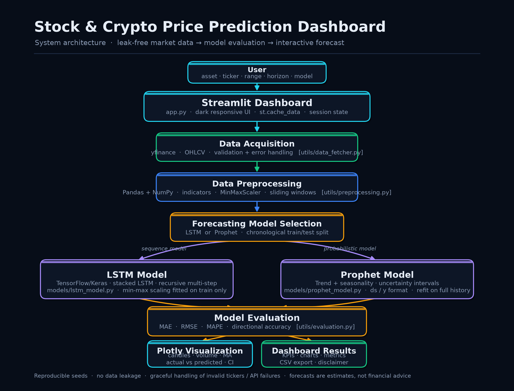

# QuantForecast — Stock & Crypto Price Prediction Dashboard

A professional, modular Streamlit dashboard for exploring stock and crypto markets, training
leak-free forecasting models, evaluating them on held-out history, and inspecting future scenarios
with interactive Plotly charts.



> Forecasts are statistical estimates, **not financial advice**. See the disclaimer at the bottom.

---

## Highlights

- **Live market data** — OHLCV history from Yahoo Finance via `yfinance`, cached with Streamlit
  (`st.cache_data`, 15-minute TTL for prices, 24 hours for metadata).
- **Stocks and crypto** — presets for AAPL, MSFT, TSLA, NVDA, BTC-USD, ETH-USD, SOL-USD and more,
  plus a free-form ticker input for any Yahoo Finance symbol.
- **Two forecasting models** — a stacked TensorFlow/Keras LSTM and Prophet, or run both side by side.
- **Leak-free evaluation** — chronological train/test split, scaler fitted on the training partition
  only, no shuffled sequences, metrics on genuinely unseen observations.
- **Metrics** — MAE, RMSE, MAPE and directional accuracy with a test-sample count.
- **Interactive charts** — close-price history, candlestick, volume, 20/50-day moving averages,
  actual vs. predicted, future forecast with uncertainty bands, and LSTM training loss.
- **Forecast horizons** — 7, 14, 30 or 90 days (business days for stocks, calendar days for crypto).
- **Downloads** — historical OHLCV CSV and a combined forecast CSV (date, model, forecast, bounds).
- **Robust UI** — invalid ticker handling, API/network errors, insufficient-history messages,
  dependency checks, and a clear financial disclaimer.
- **Tested** — 60 unit tests for data validation, preprocessing and evaluation.

---

## Architecture

```text
User
  │
  ▼
Streamlit Dashboard  ── app.py · dark responsive UI · st.cache_data · session state
  │
  ▼
Data Acquisition     ── utils/data_fetcher.py · yfinance · validation & error handling
  │
  ▼
Data Preprocessing   ── utils/preprocessing.py · Pandas/NumPy · indicators · MinMaxScaler
  │
  ▼
Forecasting Model Selection
  ├─────────────────────────────┐
  ▼                             ▼
LSTM Model                    Prophet Model
models/lstm_model.py          models/prophet_model.py
TensorFlow/Keras              trend + seasonality
recursive multi-step          uncertainty intervals
  └──────────────┬──────────────┘
                 ▼
Model Evaluation    ── utils/evaluation.py · MAE · RMSE · MAPE · direction
                 │
                 ▼
Plotly Visualization ── utils/visualization.py · candles · volume · MA · forecasts
                 │
                 ▼
Dashboard Results   ── KPIs · metrics · charts · CSV export · disclaimer
```

The diagram is generated programmatically (no Graphviz binary required):

```bash
python scripts/generate_architecture.py
```

---

## Project structure

```text
stock-crypto-dashboard/
├── app.py                       # Streamlit UI, controls, caching, orchestration
├── requirements.txt
├── README.md
├── .gitignore
├── pytest.ini
├── .streamlit/
│   └── config.toml              # dark base theme
├── assets/
│   └── architecture.png
├── models/
│   ├── __init__.py
│   ├── lstm_model.py            # TensorFlow/Keras LSTM + recursive forecast
│   └── prophet_model.py         # Prophet training, evaluation and intervals
├── scripts/
│   └── generate_architecture.py # regenerates assets/architecture.png
├── tests/
│   ├── test_data_fetcher.py
│   ├── test_preprocessing.py
│   └── test_evaluation.py
└── utils/
    ├── __init__.py
    ├── data_fetcher.py          # yfinance acquisition and OHLCV validation
    ├── preprocessing.py         # scaling, splits, windows, future dates
    ├── evaluation.py            # MAE/RMSE/MAPE/direction metrics
    └── visualization.py         # Plotly dark-theme chart builders
```

---

## Quick start

Requirements: **Python 3.11+** (tested on Python 3.13), pip, and internet access for market data.
TensorFlow and Prophet are sizable dependencies; the first install can take several minutes.

```bash
cd stock-crypto-dashboard

python3 -m venv .venv
source .venv/bin/activate          # Windows: .venv\Scripts\activate

pip install --upgrade pip
pip install -r requirements.txt

streamlit run app.py
```

Then open the URL Streamlit prints (usually <http://localhost:8501>).

### Installation notes

- **Apple Silicon / Linux / Windows:** install the latest `tensorflow` wheel as listed in
  `requirements.txt`. Intel macOS users may need Python 3.11 and TensorFlow 2.16.
- **Prophet** uses `cmdstanpy`; the wheel normally ships a prebuilt Stan backend. If fitting fails
  with a backend error, reinstall Prophet (`pip install --force-reinstall prophet`) or install
  `cmdstan` separately.
- If the app reports a dependency as unavailable, the sidebar shows which one; the other model
  remains usable.
- Streamlit's price cache lives for 15 minutes. Use the sidebar refresh/re-run controls or change a
  date to force a refetch after that window.

---

## Using the dashboard

1. **Choose an asset class** — Stocks or Crypto — and pick a ticker or enter a custom symbol.
2. **Set the historical range** — 1Y, 2Y, 5Y, 10Y, year-to-date or custom dates (minimum 30 days).
3. **Pick a horizon** — 7, 14, 30 or 90 days.
4. **Select the model** — `LSTM`, `Prophet`, or `Compare both`.
5. **Tune optional settings** in *Model settings*: test split, random seed, lookback window, epochs,
   LSTM units/batch size, Prophet changepoint flexibility, interval width, seasonality mode.
6. Press **Run Forecast**. Training progress is streamed to the dashboard; results are kept in
   session state so reruns don't retrain the same configuration.
7. Explore the tabs:
   - **Market Overview** — price line with moving averages, candlestick, volume, historical data and
     CSV download.
   - **Model Evaluation** — MAE/RMSE/MAPE cards, actual vs. predicted chart, metrics table, training
     loss, model configuration and leakage safeguards.
   - **Forecast & Export** — future forecast with uncertainty band, forecast table, end-of-horizon
     summary, and CSV download.

Typical presets: 5 years of history, 30-day horizon, LSTM lookback 60, 30 epochs.

---

## Methodology

### Data acquisition

`utils/data_fetcher.py` normalizes symbols, validates an inclusive date range, downloads daily OHLCV
bars, flattens yfinance's MultiIndex columns, coerces types, removes duplicate/missing dates and
rejects empty or too-short responses. Network/API failures are converted into readable
`DataFetchError` messages. The UI caches successful downloads, so chart interactions are fast.

### Preprocessing

`utils/preprocessing.py`:

- Extracts a clean close-price series.
- Adds 20/50-day SMAs, daily returns and percentage change.
- Splits **chronologically** (`test_size`, default 20%) — never shuffled.
- Fits `MinMaxScaler` on the **training prices only** and transforms the test partition with those
  train-derived bounds.
- Builds sliding-window sequences `(samples, window, 1)`; test windows are prefixed with the final
  training observations so each test target has a full lookback without using future data.
- Generates future business/calendar dates after the final observation.

### LSTM

`models/lstm_model.py` builds a stacked network:

```
Input(window, 1) → LSTM(units, return_sequences) → Dropout
                 → LSTM(units/2) → Dropout → Dense(32, relu) → Dense(1)
```

- Reproducible seeds (Python, NumPy, TensorFlow) and chronological training.
- Early stopping restores the best weights; sequences are never shuffled.
- Evaluation is **one-step-ahead** on the held-out test partition using only prior actual prices.
- Future prices are generated **recursively**: each prediction is appended to the window and fed
  back in, then inverse-transformed to the original price scale.
- The displayed LSTM band is a heuristic: `±1.96 × held-out RMSE × √step`. It is not a calibrated
  probability interval; use Prophet when a statistical interval is required.

### Prophet

`models/prophet_model.py` converts prices to Prophet's `ds`/`y` schema, fits a model on the training
window, scores it on the held-out dates, then refits on all history to forecast the requested future
dates. It returns `yhat`, `yhat_lower` and `yhat_upper`; the interval width is configurable (default
80%). Negative forecasts are clipped at zero for display.

### Evaluation

`utils/evaluation.py` computes:

| Metric | Meaning |
| --- | --- |
| **MAE** | Mean absolute error in price units |
| **RMSE** | Root mean squared error in price units (penalizes large misses) |
| **MAPE** | Mean absolute percentage error (zero actuals excluded) |
| **Direction** | Share of correctly predicted step-to-step moves |

All metrics are computed on the held-out test partition only. Lower MAE/RMSE/MAPE is better.

---

## Tests

```bash
source .venv/bin/activate
pytest
```

The suite covers ticker/date validation, OHLCV normalization, MultiIndex handling, fetch error paths,
indicator math, chronological splits, sequence construction, scaler leakage checks, LSTM array
alignment, future-date generation, metric values, NaN/zero handling and formatting. Tests use mocked
`yfinance.download` and do not require network access.

Expected result: **60 passed**.

---

## Regenerating the architecture diagram

```bash
python scripts/generate_architecture.py
```

This writes `assets/architecture.png` at 200 DPI using Matplotlib. Edit the script to change labels
or colors.

---

## Error handling & limitations

- **Invalid symbols / delisted tickers** — clear `DataFetchError` with symbol and range guidance.
- **Yahoo Finance rate limits** — the app caches downloads; if Yahoo returns `429`, wait a few
  minutes or try another ticker.
- **Insufficient history** — LSTM needs more than `window + test` observations; the UI explains how
  to adjust the window, split or date range.
- **Short or sparse crypto history** — Prophet needs at least 20 observations; 30+ is recommended.
- **Model uncertainty** — crypto and equities are noisy; a low test error does not imply an accurate
  future forecast. LSTM point forecasts can drift under recursive generation.
- **No survivorship/look-ahead correction for fundamentals** — this project uses price history only.
- **Metadata** — names/exchanges come from Yahoo and may be unavailable; the app falls back to the
  ticker symbol.

---

## Financial disclaimer

This project is for **educational and research purposes only**. Forecasts are statistical estimates
derived from historical prices and are not guarantees of future performance. Prophet intervals
reflect model uncertainty, not market risk. Nothing in this dashboard constitutes financial,
investment, legal or trading advice. Markets are volatile and you can lose capital. Do your own
research and consult a licensed financial professional before making investment decisions.
